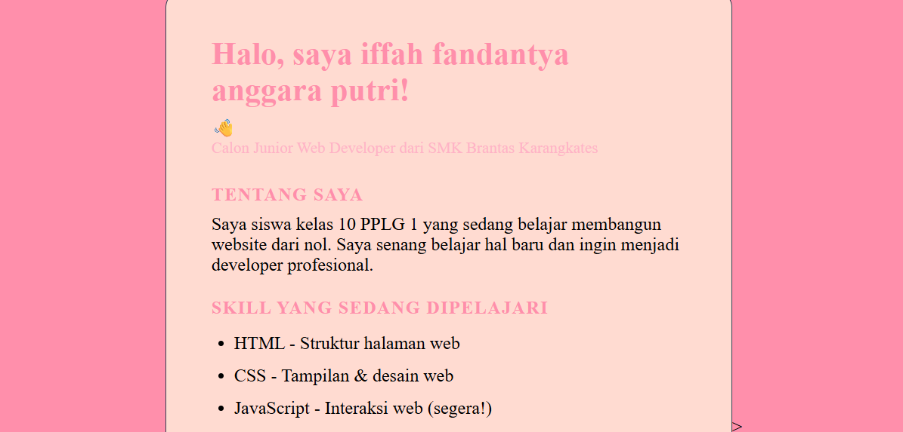

# Portofolio Iffah Fandantya Anggara Putri

Website portofolio pribadi yang saya buat di Kelas Industri UBIG
(Paket 1). Website ini menampilkan profil dan hasil proyek
serta dirancang agar tetap nyaman dibuka di ponsel, tablet, dan laptop.

## Tampilan

## Fitur
- Halaman **Beranda** berisi profil, hobi, cita-cita, keahlian, dan jadwal belajar.
- Halaman **Proyek** berisi daftar proyek dalam bentuk kartu.
- Halaman **Kontak** berisi form untuk menghubungi saya.
- Tampilan responsif menggunakan Flexbox dan media query.

## Teknologi
- HTML5
- CSS3 (Flexbox dan media query)
- JavaScript
- JSON
- Git dan GitHub
- GitHub API

## Tautan
- Website: [Portofolio Saya](https://tugas-rumah-iffah.vercel.app/)
- Dibuat oleh: Iffah Fandantya Anggara Putri, SMK Brantas Karangkates